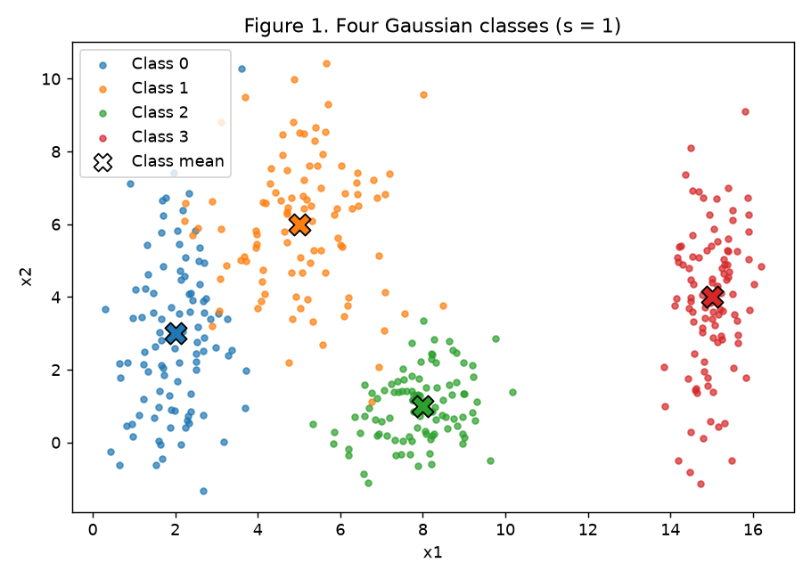
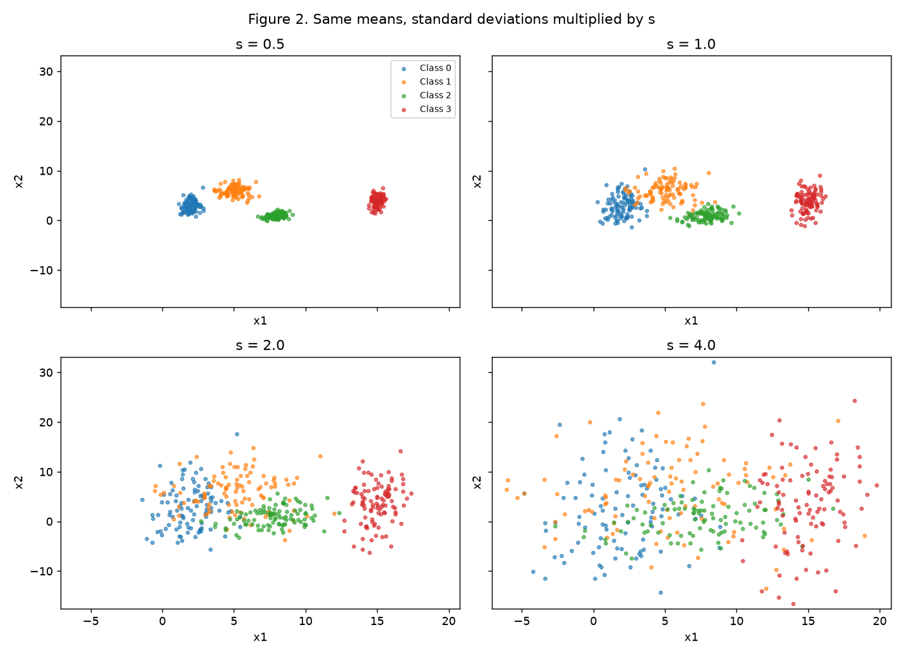
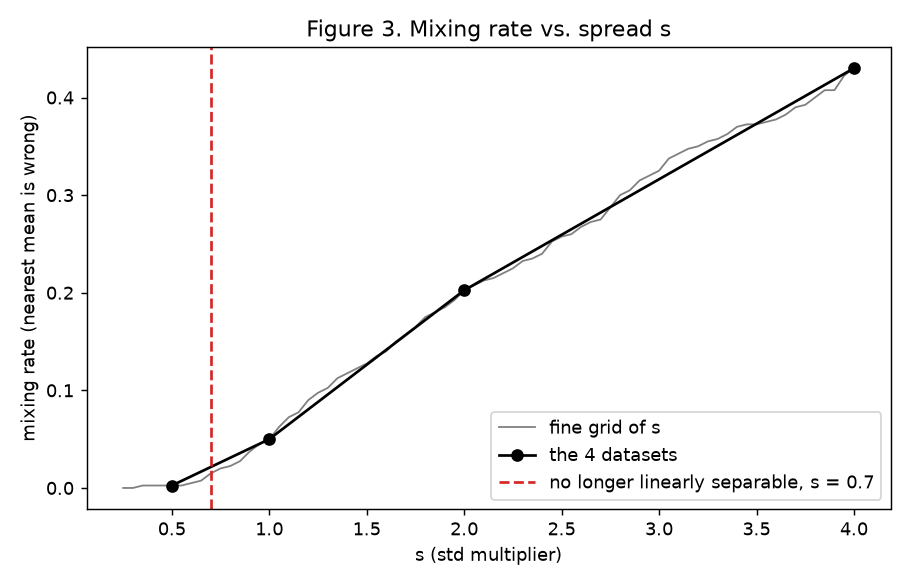
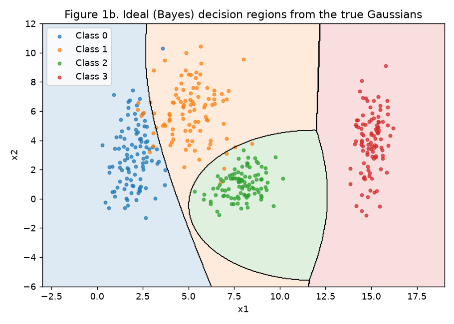
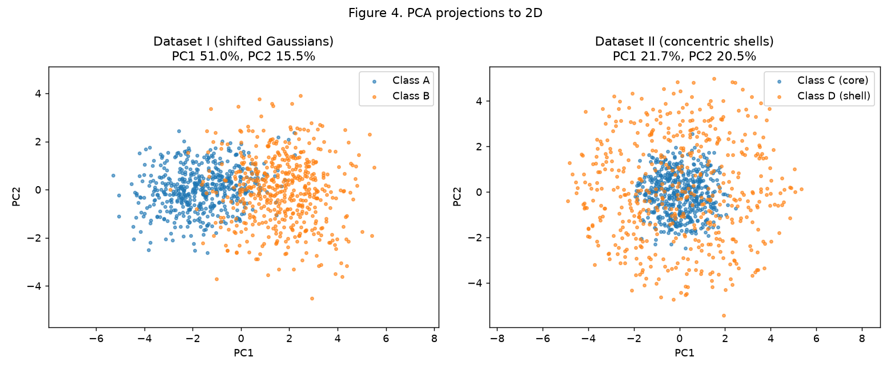
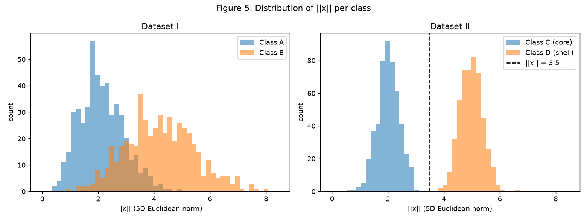
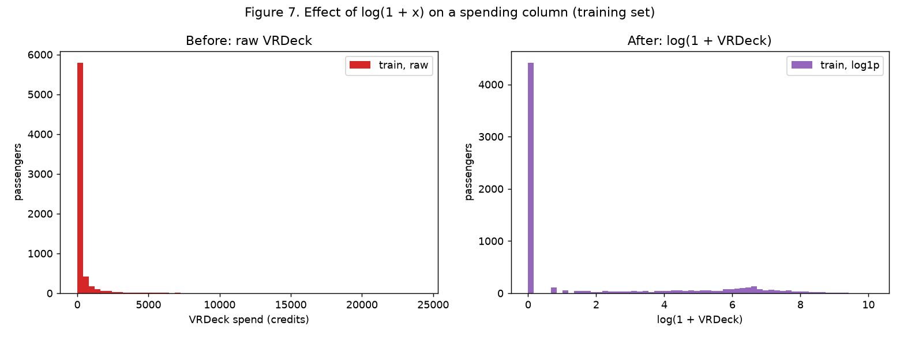
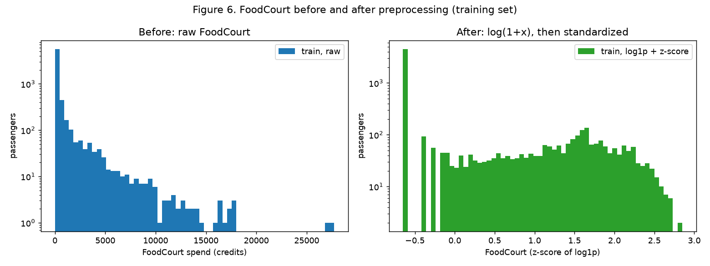

# 1. Data

## Implementation approach

Everything lives in one script, [`code/data.py`](code/data.py), using NumPy, pandas, Matplotlib, scikit-learn (only `PCA` and `OneHotEncoder`) and SciPy's `linprog` (an exact feasibility check, not a model). It builds every dataset, saves Figures 1 to 7 to `figures/` and writes every number quoted below to [`code/results.json`](code/results.json). The Spaceship Titanic `train.csv` (8693 rows, the Kaggle file) is versioned in [`data/train.csv`](data/train.csv). The site's CI workflow runs this script before `mkdocs gh-deploy`, so the figures and `results.json` shown here are regenerated from the code on every deploy. To reproduce locally from the repository root:

```bash
pip install numpy pandas matplotlib scikit-learn scipy
python docs/exercises/data/code/data.py
```

Design choices:

- **One generator.** `rng = np.random.default_rng(42)` is created once and used, in this order, for: the Exercise 1 noise, Dataset I, Dataset II, and the Exercise 3 train/test split. Nothing else draws random numbers. The split is implemented by hand with `rng.permutation` inside each class (instead of `train_test_split(random_state=...)`) so that the rule "same `rng` throughout" holds literally.
- **Same noise for every spread.** In Exercise 1 the standard-normal noise `Z` (100 × 2 per class) is drawn once, and the dataset with spread s is `mean + s · std · Z`. The four datasets of item B therefore differ only in spread, and s = 1 is exactly the Figure 1 dataset.
- **Linear separability is tested, not guessed.** The mixing rate uses the nearest-mean rule, which is only one particular set of straight boundaries. To answer "can the classes be separated by straight lines" I also solve a linear programme: does a linear layer with argmax (weights W, biases b) exist that puts every point in its own class with margin 1? Feasible means yes. Nothing is fitted to minimise an error, so no model is trained.
- **No leakage in Exercise 3.** The split happens first; every median, mode, mean, std and the list of categories is computed on the training rows and then applied unchanged to the test rows.

Code (pulled from the file that was run):

``` python
--8<-- "docs/exercises/data/code/data.py"
```

## Exercise 1

### A. Generate the clouds

400 samples, 100 per class, each class an axis-aligned Gaussian:

| Class | Mean | Std |
|---|---|---|
| 0 | [2, 3] | [0.8, 2.5] |
| 1 | [5, 6] | [1.2, 1.9] |
| 2 | [8, 1] | [0.9, 0.9] |
| 3 | [15, 4] | [0.5, 2.0] |



*Figure 1. Classes 0, 1 and 2 sit close together on the left and touch each other; class 3 is isolated on the right. The X markers are the class means.*

### B. Spread

**1. Four spreads.** Same means and noise, all standard deviations multiplied by s ∈ {0.5, 1, 2, 4}.



*Figure 2. Shared axis limits. At s = 0.5 the four clouds are compact and apart; at s = 4 classes 0, 1 and 2 are one blob and class 3 starts to merge with class 2.*

**2. Separation ratio at s = 1.** r_ij = ‖μi − μj‖ / (σ̄i + σ̄j), with σ̄ = [1.65, 1.55, 0.90, 1.25] for classes 0 to 3.

| Pair | ‖μi − μj‖ | r_ij (s = 1) | r_ij (s = 2) |
|---|---|---|---|
| **0-1** | 4.243 | **1.326** | **0.663** |
| 0-2 | 6.325 | 2.480 | 1.240 |
| 0-3 | 13.038 | 4.496 | 2.248 |
| 1-2 | 5.831 | 2.380 | 1.190 |
| 1-3 | 10.198 | 3.642 | 1.821 |
| 2-3 | 7.616 | 3.542 | 1.771 |

The smallest pair is **0-1 with r = 1.326**. Multiplying every std by s multiplies every σ̄ by s and leaves the means unchanged, so r_ij(s) = r_ij(1) / s. At s = 2 it becomes **1.326 / 2 = 0.663**: the distance between the two means is now smaller than the sum of their average spreads.

**3. Mixing rate** (share of points whose nearest true class mean is not their own):

| s | 0.5 | 1.0 | 2.0 | 4.0 |
|---|---|---|---|---|
| Mixing rate | 0.25% (1 point) | 5.00% | 20.25% | 43.00% |
| Linearly separable (all 4 classes)? | yes | no | no | no |

At s = 1 the 20 mixed points are 8 of class 0 closer to μ1, 6 of class 1 closer to μ0 and 6 of class 1 closer to μ2. At s = 4 even class 3 loses 22 points (20 of them to class 2).

**4. Figure 3.**



*Figure 3. Mixing rate vs. s. Black dots are the four datasets; the grey line repeats the computation for s from 0.25 to 4 in steps of 0.05 with the same noise. The red line marks where the linear programme becomes infeasible.*

On the fine grid the classes are **linearly separable up to s = 0.65 and not from s = 0.70 on** (and never again for larger s). So the scale is **s ≈ 0.7**. There the smallest ratio is r_01 = 1.326 / 0.7 ≈ **1.89** (2.04 at s = 0.65): once the two closest means are less than about two "average spreads" apart, the tails of classes 0 and 1 cross and no straight line keeps them apart. The pair tests confirm it is 0-1 and 1-2 that break first.

Note that the nearest-mean rule already makes mistakes at s = 0.35, well before separability is lost (at s = 0.5 one point is "mixed" but a set of lines still separates everything). Class 0 is very elongated in x2 (std 2.5), so a point at the top of class 0 can be closer to μ1 than to μ0 while still being on the class-0 side of a well-placed line. The mixing rate is a measure of overlap, not a proof of non-separability.

### C. Analysis

**1. Overlap at s = 1.** Class 3 is far from everyone (r ≥ 3.5) and class 2 only touches class 1 at its upper-left edge. The real overlap is between classes 0 and 1 (r = 1.33): the top of class 0, which is stretched vertically, enters the bottom-left of class 1. The linear programme says the pairs 0-1 and 1-2 are not linearly separable at s = 1, while 0-2, 0-3, 1-3 and 2-3 are. **One single linear boundary cannot separate four classes at all**: a line only splits the plane in two half-planes, so at best it isolates one group (e.g. class 3 from the rest). **A set of linear boundaries** (three or more lines, or a linear layer with 4 outputs and argmax) gets almost everything right, but not 100% at s = 1: the few points of 0 and 1 that sit inside each other's cloud cannot be fixed by any straight boundary.

**2. Sketch of the boundaries.** Figure 1b draws the boundaries an ideal classifier would use, computed directly from the known generating Gaussians (Bayes rule, equal priors, nothing fitted). A trained network would learn something close to it:



*Figure 1b. Ideal regions. A near-vertical, slightly curved line around x1 ≈ 3 to 6 between classes 0 and 1; a closed oval around class 2 (it is the tightest class, so its region is small and round); a vertical line near x1 ≈ 11.5 that cuts off class 3.*

The boundaries are curved because the classes have different covariances (a quadratic discriminant). A small MLP with tanh units would approximate these curves with a few bent pieces; a purely linear model would replace them with straight segments and lose a few points near the 0-1 and 1-2 frontiers.

**3. Relation to part B.** The boundaries in Figure 1b depend only on the means and on the ratio between the class covariances, so they barely move when s grows. What grows is the share of each cloud that falls on the wrong side of them: the region where the network must make errors goes from a thin strip between classes 0 and 1 at s = 1 (5% mixing) to most of the left half of the plane at s = 4 (43%). No architecture can avoid those errors, because at that point the same (x1, x2) is genuinely produced by two different classes; more capacity would only fit noise.

## Exercise 2

### A. Dataset I (shifted Gaussians)

Class A: 500 samples, mean 0, covariance Σ_A (positive correlation 0.8 between features 1 and 2). Class B: 500 samples, mean [1.5, …, 1.5], covariance Σ_B (larger variances, 1.5, and correlation −0.7 between features 1 and 2). Both matrices are valid covariances: their smallest eigenvalues are 0.158 and 0.498, both positive.

### B. Dataset II (concentric shells)

500 samples per class. Direction u = v / ‖v‖ with v ~ N(0, I₅) (uniform on the 5D unit sphere), radius ρ ~ N(2.0, 0.4) for the core (class C) and ρ ~ N(5.0, 0.4) for the shell (class D), point x = ρ · u.

### C. Visualize and compare

**1. Figure 4.**



*Figure 4. PCA to 2D, one PCA per dataset fitted on both classes. Dataset I: the two classes are side by side along PC1, with a band of overlap. Dataset II: the core is a dense disk in the middle and the shell is spread around and over it.*

**2. Explained variance.**

| | PC1 | PC2 | PC1 + PC2 |
|---|---|---|---|
| Dataset I | 51.0% | 15.5% | **66.4%** |
| Dataset II | 21.7% | 20.5% | **42.1%** |

**Dataset I's projection preserves the classification information much better.** There the largest source of variance is the shift between the classes, so PC1 is almost the direction from μ_A to μ_B (|cos| = 0.99 with [1, 1, 1, 1, 1]/√5): the projection keeps exactly what separates them. Dataset II is spherically symmetric: every direction has the same variance (about 1/5 each, which is why PC1 and PC2 are both ≈ 21%), PCA has no preferred direction, and the useful information (the radius) is spread over all five coordinates. A 2D projection only sees part of ‖x‖, so shell points whose direction is mostly in the three discarded coordinates land in the middle, on top of the core.

**3. In 5D.**

- Distance between the class centers (sample means): **Dataset I: 3.356** (theory: ‖[1.5]·5‖ = 1.5√5 = 3.354). **Dataset II: 0.261** (theory: 0, both shells are centered at the origin; 0.26 is sampling noise).



*Figure 5. Histograms of ‖x‖ per class. Dataset I: the radii overlap a lot (A mean 2.13, B mean 4.22), because a shift is not a change in radius. Dataset II: two separate bumps; the largest core radius is 2.99 and the smallest shell radius is 3.85, so the dashed line ‖x‖ = 3.5 separates them with no error.*

### D. Analysis

**1. Same center, separate radii.** A hyperplane w·x + b = 0 classifies a point by which side of it the point is on. Its decision depends on a linear projection w·x, and the average of w·x over a class is w·μ. When the two centers coincide, both classes have the same average on *every* hyperplane, and by symmetry each shell puts half of its points on each side of any hyperplane through the middle. The information that separates them, the distance to the origin, is not a direction in space, so no hyperplane captures it.

**2. Why no linear boundary works, however much data.** The core is a solid ball around the origin and the shell surrounds it in every direction. Take any hyperplane. If it passes through the ball, it also cuts the shell, with shell points on both sides. If it leaves the whole ball on one side, the shell still has points on that same side (the cap of the shell that faces the same way). So every half-space that contains the core also contains part of the shell. This is a property of the geometry, not of the sample: adding more data only fills the shell more densely and makes the contradiction certain. The best a hyperplane can do is cut off one cap of the shell and call everything else core, which leaves most of the shell misclassified; it can never reach the 100% of the radius rule below.

**3. Does a mixed PCA plot prove inseparability?** No. PCA is a linear projection that keeps the directions of largest variance, not the directions that separate classes, and it throws away 3 of the 5 dimensions. In Figure 4 Dataset II looks mixed, yet in 5D the classes are perfectly separable by a simple non-linear rule:

f(x) = ‖x‖² − 12.25 = x₁² + x₂² + x₃² + x₄² + x₅² − 3.5², predict *shell* if f(x) > 0.

This rule classifies **all 1000 points correctly (100%)**, as Figure 5 already suggests. The threshold 3.5 is halfway between the two mean radii. Equivalently: adding the single feature ‖x‖² makes Dataset II linearly separable, which is exactly the kind of feature a hidden layer can learn.

## Exercise 3

### A. Get to know the data

**1. Data.** `train.csv` from the Kaggle Spaceship Titanic competition: 8693 rows, 14 columns.

**2. Target.** `Transported` says whether the passenger was transported to another dimension when the ship hit the spacetime anomaly (True/False). It is the label to predict. Balance: **4378 True (50.36%)** and 4315 False (49.64%), practically balanced, so accuracy is a meaningful metric and no reweighting is needed.

**3. Feature types.**

- Numerical: Age, RoomService, FoodCourt, ShoppingMall, Spa, VRDeck (the last five are credits spent on board).
- Categorical: HomePlanet (Earth, Europa, Mars), CryoSleep (True/False), Destination (TRAPPIST-1e, 55 Cancri e, PSO J318.5-22), VIP (True/False), Cabin (deck/number/side string).
- Identifiers / free text: PassengerId, Name.

**4. Missing values.**

| Column | Missing | % |
|---|---|---|
| PassengerId | 0 | 0.00 |
| HomePlanet | 201 | 2.31 |
| CryoSleep | 217 | 2.50 |
| Cabin | 199 | 2.29 |
| Destination | 182 | 2.09 |
| Age | 179 | 2.06 |
| VIP | 203 | 2.34 |
| RoomService | 181 | 2.08 |
| FoodCourt | 183 | 2.11 |
| ShoppingMall | 208 | 2.39 |
| Spa | 183 | 2.11 |
| VRDeck | 188 | 2.16 |
| Name | 200 | 2.30 |
| Transported | 0 | 0.00 |

Each column only misses about 2%, but the gaps are spread over different rows: **2087 rows (24%) have at least one NaN**, so dropping incomplete rows would throw away a quarter of the data.

**5. Spending columns** (full file, NaN ignored):

| Column | Mean | Median | Max | Share of zeros |
|---|---|---|---|---|
| RoomService | 224.7 | 0 | 14 327 | 64.2% |
| FoodCourt | 458.1 | 0 | 29 813 | 62.8% |
| ShoppingMall | 173.7 | 0 | 23 492 | 64.3% |
| Spa | 311.1 | 0 | 22 408 | 61.2% |
| VRDeck | 304.9 | 0 | 24 133 | 63.2% |

All medians are 0 while the means are in the hundreds and the maxima in the tens of thousands. Most passengers spend nothing, and a small group spends a lot: the mean is pulled up by the long right tail, so the distributions are **extremely right-skewed** (FoodCourt skewness on the training set: 6.6) and the spread is dominated by a few outliers. The median describes the typical passenger; the mean does not.

### B. Split before transforming

Stratified 80/20 split by `Transported`, done with the same `rng`: **6954 train / 1739 test rows**, with 50.36% and 50.37% True respectively.

The test set must behave like data the model has never seen. If medians, means, stds or the category list are computed on the full file, information from the test rows enters the training features (data leakage) and the test score becomes optimistic. So the split comes first, and every statistic below is fitted on the 6954 training rows only and then applied to the test rows.

### C. Preprocess

**1. Missing data** (fitted on train, applied to test):

- **Categorical** (HomePlanet, CryoSleep, Destination, VIP): **training mode** (Earth, False, TRAPPIST-1e, False). Each column misses only 2 to 2.5%, the mode is the most likely value, and it does not create an extra one-hot column.
- **Spending**: if the passenger is in CryoSleep, the missing value is set to **0**; I checked on the training set that the maximum total spend of CryoSleep passengers is exactly 0, so this is a fact, not a guess. Otherwise the **training median**, which is 0 for all five columns. The median (not the mean) is used because of the skew in A.5: the mean (≈ 450 for FoodCourt) would describe almost nobody.
- **Age**: **training median, 27**. Robust to the right tail of ages (max 79).

**2. One-hot encoding** of HomePlanet, CryoSleep, Destination and VIP with scikit-learn's `OneHotEncoder(handle_unknown="ignore")`, fitted on train only. The encoder stores the categories it saw in train. A category that appears only in test (e.g. `HomePlanet = "Pluto"`) does not raise an error and does not create a new column: its block of the row is all zeros (the script checks this and gets [0, 0, 0] for the HomePlanet block). The network then sees "none of the known planets", which is the honest input, and the matrix keeps the same 17 columns for train and test.

**3. Feature engineering.** `TotalSpend` = RoomService + FoodCourt + ShoppingMall + Spa + VRDeck (computed after imputation). Cabin, Name and PassengerId are dropped.

**4. Heavy tails.** log(1 + x) on the five spending columns and on TotalSpend. log(1 + 0) = 0, so the many zeros stay zeros, and a spend of 29 813 becomes 10.3.



*Figure 7. VRDeck on the training set. Before: everything is squeezed into the first bar and the tail up to 24 133 is invisible. After: a spike at 0 (non-spenders) and a readable bump between about 1 and 9 (centred near 5.5) for the passengers who spend.*

Why this helps a tanh network: tanh is only sensitive (non-saturated) for inputs roughly in [−2, 2]. Without the log, after scaling the few big spenders would have z-scores of 20 or more, pushing neurons into the flat part of tanh where the gradient is ≈ 0, and they would dominate the weight updates while the typical passenger is crushed near one value. The log compresses the tail (FoodCourt skewness goes from 6.6 to 1.1) so the scaled values stay in the useful range.

**5. Scaling.** **Standardization** (z-score) of the 7 numerical columns (Age + 5 spending + TotalSpend), with mean and std from train. I chose it over [−1, 1] min-max because min-max is set by the single largest value, which is still an outlier after the log, and because z-scores centre each feature at 0, where tanh has its maximum slope. After scaling, every numerical training column has mean 0.000 and std 1.000. One-hot columns stay 0/1.

- **Train: min −2.010, max 3.497.**
- **Test: min −2.010, max 3.497.**

Both extremes come from Age (ages 0 and 79 occur in both sets). Per column on train, the spending features range from about −0.66 to 3.28 and TotalSpend from −1.15 to 1.65.

### D. Verify and visualize

**1. Figure 6.**



*Figure 6. FoodCourt on the training set, counts on a log axis in both panels. Before: raw credits from 0 to almost 30 000, monotonically decreasing tail. After log(1 + x) and z-score: values between −0.65 and 2.85; the non-spenders form the bar at −0.65 and the spenders a bump around 1 to 2.*

**2. Final checks.**

- **NaN left: 0** in train and 0 in test.
- **Final shape: train 6954 × 17, test 1739 × 17** (7 numerical + 3 HomePlanet + 2 CryoSleep + 3 Destination + 2 VIP).
- **Range:** every value is in [−2.01, 3.50]. Only 4.6% of the numerical training entries have |z| > 2. This suits tanh: the inputs are centred, of order 1, and few of them would push a unit with small initial weights into saturation.

**3. Which decision matters most.** The **log transform of the spending columns** is the one that most affects training. Five of the seven numerical features (plus TotalSpend) are spending, and without the log their standardized values would range from −0.3 to more than 20: a few rich passengers would saturate the tanh units and produce huge gradients, while the 63% who spend nothing and the moderate spenders would look almost identical. Imputation touches only about 2% of each column, and standardization alone cannot fix a skewed shape (it only shifts and rescales it), so the log is what turns these columns into inputs a tanh network can actually learn from.

## Results summary

| # | Quantity | Value |
|---|---|---|
| 1 | Mixing rate at s = 0.5 | 0.25% (1 of 400) |
| 2 | Mixing rate at s = 1.0 | 5.00% (20 of 400) |
| 3 | Mixing rate at s = 2.0 | 20.25% (81 of 400) |
| 4 | Mixing rate at s = 4.0 | 43.00% (172 of 400) |
| 5 | Smallest r_ij at s = 1.0, and its pair | 1.326, pair 0-1 |
| 6 | Distance between centers, Dataset I | 3.356 |
| 7 | Distance between centers, Dataset II | 0.261 |
| 8 | Explained variance PC1 + PC2, Dataset I | 66.4% |
| 9 | Explained variance PC1 + PC2, Dataset II | 42.1% |
| 10 | Share of the positive class in `Transported` | 50.36% |
| 11 | Mean and median of FoodCourt on the training set, before transforming | mean 450.80, median 0 |
| 12 | Final shape of the training feature matrix | 6954 × 17 |
| 13 | Min and max of the training and test sets after scaling | train [−2.010, 3.497]; test [−2.010, 3.497] |
