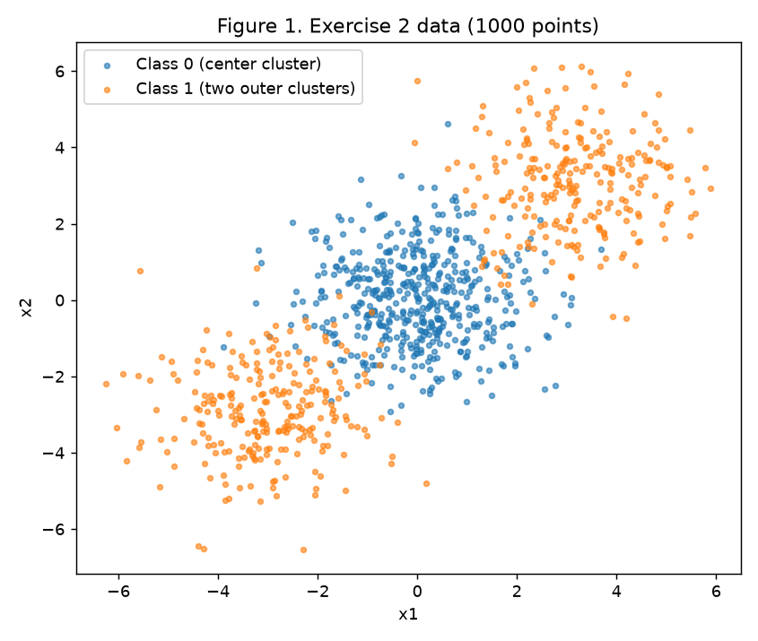
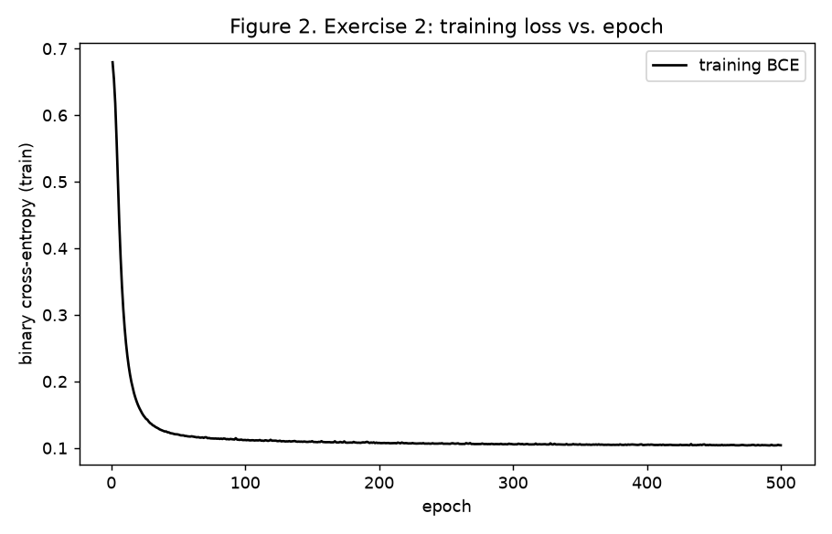
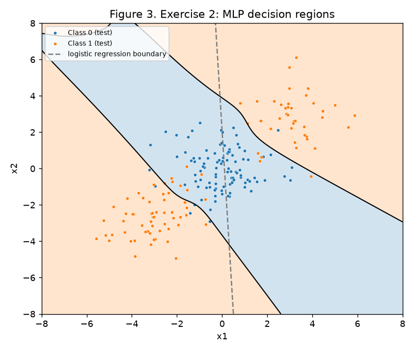
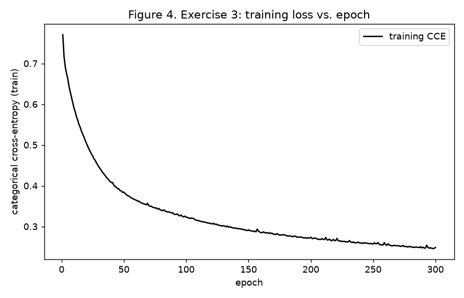
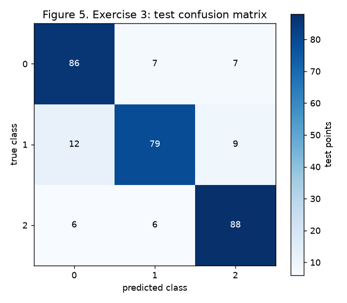
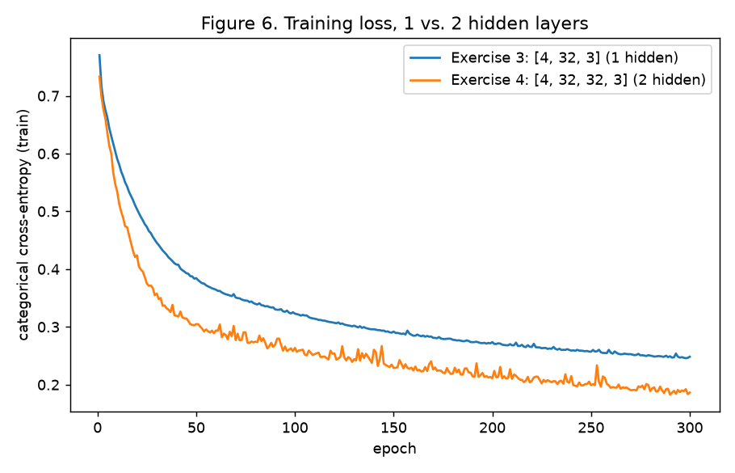

# 3. MLP

## Implementation approach

Everything lives in one script, [`code/mlp.py`](code/mlp.py), with NumPy and Matplotlib. scikit-learn is used only where the statement allows it: `make_blobs`, `make_classification`, `train_test_split`, `confusion_matrix` and the two `LogisticRegression` baselines. The script saves Figures 1 to 6 to `figures/` and writes every number quoted below to [`code/results.json`](code/results.json). The site's CI workflow runs it before deploying and commits the figures and `results.json` back to the repository. To reproduce locally from the repository root:

```bash
pip install numpy matplotlib scikit-learn
python docs/exercises/mlp/code/mlp.py
```

Design choices:

- **One generator.** `rng = np.random.default_rng(42)` is created once and used for every weight initialization and every mini-batch shuffle, in script order. The dataset functions and the split use `random_state=42`, as the statement prescribes.
- **One network class for everything.** `MLP(sizes, output, rng)` takes the layer sizes as an argument (e.g. `[2, 8, 1]`, `[4, 32, 32, 3]`). Hidden layers use tanh, and weights use Xavier/Glorot-normal initialization (std √(2 / (fan_in + fan_out)), suited to tanh) with zero biases. `forward`, `backward` and `step` are written once and reused unchanged in Exercises 2, 3 and 4 (see 3.B).
- **Mini-batch gradient descent**, batch size 32, data reshuffled every epoch. The training loss recorded for the figures is the loss on the full training set at the end of each epoch.
- **Gradient check.** At the end of the script, `backward()` is compared with central finite differences on a small random batch. The maximum relative error is 7.2 × 10⁻⁸ for sigmoid + BCE on `[2, 8, 1]` and 7.0 × 10⁻⁷ for softmax + CCE on `[4, 32, 32, 3]`, so the hand-derived gradients are correct. This check runs after everything else, so it does not change the random stream used above.

Code (pulled from the file that was run):

``` python
--8<-- "docs/exercises/mlp/code/mlp.py"
```

## Exercise 1

Network 2 → 2 → 1, tanh in both layers, L = (y − ŷ)². Values: x = [0.5, −0.2], y = 1.0, W⁽¹⁾ = [[0.3, −0.1], [0.2, 0.4]] (row i = weights into hidden neuron i), b⁽¹⁾ = [0.1, −0.2], W⁽²⁾ = [0.5, −0.3], b⁽²⁾ = 0.2, η = 0.3. Everything below is done by hand, rounded to 6 decimals (the script only re-checks the numbers).

### A. Forward pass

Pre-activation of the hidden layer, z⁽¹⁾ = W⁽¹⁾x + b⁽¹⁾:

- z₁⁽¹⁾ = 0.3·0.5 + (−0.1)·(−0.2) + 0.1 = 0.15 + 0.02 + 0.1 = **0.270000**
- z₂⁽¹⁾ = 0.2·0.5 + 0.4·(−0.2) + (−0.2) = 0.10 − 0.08 − 0.20 = **−0.180000**

Hidden activation, h⁽¹⁾ = tanh(z⁽¹⁾):

- h₁⁽¹⁾ = tanh(0.27) = **0.263625**
- h₂⁽¹⁾ = tanh(−0.18) = **−0.178081**

Output pre-activation, u⁽²⁾ = W⁽²⁾·h⁽¹⁾ + b⁽²⁾:

- u⁽²⁾ = 0.5·0.263625 + (−0.3)·(−0.178081) + 0.2 = 0.131812 + 0.053424 + 0.2 = **0.385237**

Output and loss:

- ŷ = tanh(0.385237) = **0.367247**
- L = (1 − 0.367247)² = 0.632753² = **0.400377**

### B. Backward pass

**Start.** ∂L/∂ŷ = −2(y − ŷ) = −2 · 0.632753 = **−1.265507**.

**1. Output pre-activation.** tanh′(u⁽²⁾) = 1 − ŷ² = 1 − 0.367247² = 1 − 0.134870 = 0.865130.
∂L/∂u⁽²⁾ = ∂L/∂ŷ · (1 − ŷ²) = −1.265507 · 0.865130 = **−1.094828**. Call it δ⁽²⁾.

**2. Output layer parameters.** u⁽²⁾ = Σⱼ W⁽²⁾ⱼ hⱼ⁽¹⁾ + b⁽²⁾, so ∂u⁽²⁾/∂W⁽²⁾ⱼ = hⱼ⁽¹⁾ and ∂u⁽²⁾/∂b⁽²⁾ = 1.

- ∂L/∂W₁⁽²⁾ = δ⁽²⁾ · h₁⁽¹⁾ = −1.094828 · 0.263625 = **−0.288624**
- ∂L/∂W₂⁽²⁾ = δ⁽²⁾ · h₂⁽¹⁾ = −1.094828 · (−0.178081) = **0.194968**
- ∂L/∂b⁽²⁾ = δ⁽²⁾ = **−1.094828**

**3. Hidden layer.** ∂u⁽²⁾/∂hⱼ⁽¹⁾ = W⁽²⁾ⱼ, and tanh′(zⱼ⁽¹⁾) = 1 − (hⱼ⁽¹⁾)².

- ∂L/∂h₁⁽¹⁾ = δ⁽²⁾ · W₁⁽²⁾ = −1.094828 · 0.5 = **−0.547414**
- ∂L/∂h₂⁽¹⁾ = δ⁽²⁾ · W₂⁽²⁾ = −1.094828 · (−0.3) = **0.328448**
- 1 − (h₁⁽¹⁾)² = 1 − 0.069498 = 0.930502, and 1 − (h₂⁽¹⁾)² = 1 − 0.031713 = 0.968287
- ∂L/∂z₁⁽¹⁾ = −0.547414 · 0.930502 = **−0.509370**
- ∂L/∂z₂⁽¹⁾ = 0.328448 · 0.968287 = **0.318032**

Call these δ⁽¹⁾ = [−0.509370, 0.318032].

**4. Hidden layer parameters.** zᵢ⁽¹⁾ = Σₖ W⁽¹⁾ᵢₖ xₖ + bᵢ⁽¹⁾, so ∂L/∂W⁽¹⁾ᵢₖ = δᵢ⁽¹⁾ xₖ and ∂L/∂bᵢ⁽¹⁾ = δᵢ⁽¹⁾.

- ∂L/∂W⁽¹⁾₁₁ = −0.509370 · 0.5 = **−0.254685**
- ∂L/∂W⁽¹⁾₁₂ = −0.509370 · (−0.2) = **0.101874**
- ∂L/∂W⁽¹⁾₂₁ = 0.318032 · 0.5 = **0.159016**
- ∂L/∂W⁽¹⁾₂₂ = 0.318032 · (−0.2) = **−0.063606**
- ∂L/∂b⁽¹⁾ = **[−0.509370, 0.318032]**

### C. Parameter update

θ ← θ − η · ∂L/∂θ with η = 0.3:

| Parameter | Old | Gradient | New |
|---|---|---|---|
| W⁽¹⁾₁₁ | 0.3 | −0.254685 | 0.3 + 0.076406 = **0.376405** |
| W⁽¹⁾₁₂ | −0.1 | 0.101874 | −0.1 − 0.030562 = **−0.130562** |
| W⁽¹⁾₂₁ | 0.2 | 0.159016 | 0.2 − 0.047705 = **0.152295** |
| W⁽¹⁾₂₂ | 0.4 | −0.063606 | 0.4 + 0.019082 = **0.419082** |
| b⁽¹⁾₁ | 0.1 | −0.509370 | 0.1 + 0.152811 = **0.252811** |
| b⁽¹⁾₂ | −0.2 | 0.318032 | −0.2 − 0.095410 = **−0.295410** |
| W⁽²⁾₁ | 0.5 | −0.288624 | 0.5 + 0.086587 = **0.586587** |
| W⁽²⁾₂ | −0.3 | 0.194968 | −0.3 − 0.058490 = **−0.358490** |
| b⁽²⁾ | 0.2 | −1.094828 | 0.2 + 0.328448 = **0.528448** |

(W⁽¹⁾₁₁ is 0.3 + 0.0764055; it rounds to 0.376405 because the unrounded gradient is −0.2546849.)

**The loss would fall.** Every parameter moved opposite to its gradient, and to first order the change in loss is ΔL ≈ −η‖∇L‖², which is negative. Concretely, the output was too small (ŷ = 0.367 < y = 1), and every update pushes u⁽²⁾ up: b⁽²⁾ grows, the positive weight on the positive h₁ grows, and the negative weight on the negative h₂ becomes more negative. A second forward pass with the new parameters gives ŷ ≈ 0.7112 and L ≈ **0.0834**, down from 0.4004 (checked numerically in the script).

## Exercise 2

### A. Data

`make_blobs` with centers [[0, 0], [3, 3], [−3, −3]], 500/250/250 points, `cluster_std=1.2`, `random_state=42`. Class 0 is the center cluster (500 points), class 1 is the two outer clusters together (500 points). Split 80/20, stratified, `random_state=42`: 800 train, 200 test.



*Figure 1. Class 0 sits in the middle; class 1 is on both sides of it, along the diagonal.*

### B. Baseline

Logistic regression on the training set: **test accuracy 47.5%**, below chance. The fitted weights are almost zero (w = [0.030, 0.001], b = −0.003), so the model predicts ≈ 0.5 everywhere and its "boundary" (dashed line in Figure 3) is essentially arbitrary.

### C. MLP from scratch

- **Architecture:** 2 → 8 (tanh) → 1 (sigmoid), 33 parameters.
- **Loss:** binary cross-entropy, L = −(1/N) Σ [y log p + (1 − y) log(1 − p)].
- **Backward:** with a sigmoid output, ∂L/∂u = (p − y)/N at the output; then for each layer, going backwards: ∂L/∂W = aᵀδ, ∂L/∂b = Σδ, δ_prev = (δWᵀ) ⊙ (1 − a²) for the tanh layer below.
- **Training:** learning rate 0.1, 500 epochs, batch size 32.
- **Test accuracy: 91.0%** (train 96.5%). Training loss fell from 0.679 after epoch 1 to 0.104 after epoch 500.



*Figure 2. Training BCE per epoch. Most of the drop happens in the first 50 epochs; after that the loss slowly flattens around 0.10.*



*Figure 3. Decision regions of the MLP over a grid (blue = class 0, orange = class 1), with the test points. The dashed line is the logistic-regression boundary.*

### D. Analysis

**Why the line fails.** The two class-1 clusters are centered at (3, 3) and (−3, −3), so the mean of class 1 is (0, 0), exactly the mean of class 0. A straight line splits the plane into two half-planes. To get the center cluster right, the line must put (0, 0) on the class-0 side, but then at least one of the two outer clusters, which lie in opposite directions from the center, falls on the same side. Any line therefore gets about half of class 1 wrong, or cuts the center cluster in two. Logistic regression, which looks for one direction w where the classes differ on average, finds none (w ≈ 0 because the class means coincide). Its predictions are near 0.5 for every point, so the accuracy is set by noise and lands at 47.5%.

**What the MLP builds.** In Figure 3 the class-0 region is a **band**: a strip running from the upper left to the lower right, perpendicular to the diagonal on which the three clusters lie. Class 1 is the union of **two separate regions**, one on each side of the strip. That shape needs at least two boundaries: one on the (3, 3) side and one on the (−3, −3) side. Each hidden tanh unit is a soft step across its own line, and the output adds them up, so with two or more units the network can say "class 1 if beyond the upper boundary **or** beyond the lower one", which is exactly what this data requires. A single line can only make one half-plane, and a half-plane is convex. Here class 1 is not even connected (two pieces on opposite sides), so no half-plane can contain both pieces without also containing the strip between them. (The small blue patch at the top-left corner of the grid is an extrapolation artifact far from any data point.)

## Exercise 3

### A. Data

`make_classification` with 1500 samples, 4 features (all informative), 3 classes, 2 clusters per class, `class_sep=1.0`, `random_state=42`. Split 80/20 stratified with `random_state=42`: 1200 train, 300 test (100 per class).

### B. Adaptation

The output layer has 3 units, softmax gives the probabilities, and the loss is categorical cross-entropy.

**Derivation of ∂L/∂u for softmax + CCE.** For one sample with logits u = (u₁, …, u_K), pₖ = e^{uₖ} / Σⱼ e^{uⱼ} and L = −Σₖ yₖ log pₖ, with y one-hot (Σₖ yₖ = 1).

1. Softmax Jacobian: ∂pₖ/∂uᵢ = pₖ(δₖᵢ − pᵢ), where δₖᵢ = 1 if k = i, else 0.
2. Chain rule: ∂L/∂uᵢ = −Σₖ (yₖ / pₖ) · ∂pₖ/∂uᵢ = −Σₖ yₖ (δₖᵢ − pᵢ) = −yᵢ + pᵢ Σₖ yₖ.
3. Since Σₖ yₖ = 1: **∂L/∂uᵢ = pᵢ − yᵢ**. Averaged over a batch of N samples: ∂L/∂U = (P − Y)/N.

This is the same form as sigmoid + BCE in Exercise 2, where ∂L/∂u = (p − y)/N. That is why `backward()` starts from `delta = (A[-1] - Y) / N` and serves both cases.

**Extra point: code reused unchanged.** Exercises 2, 3 and 4 call the same `MLP.forward`, `MLP.backward`, `MLP.step` and `train` functions, with no edits and no `if` on the task. What changes: the sizes (`[2, 8, 1]` → `[4, 32, 3]` → `[4, 32, 32, 3]`), the loss (`bce` → `cce`), the output nonlinearity that goes with that loss (`"sigmoid"` → `"softmax"`, passed as an argument), and the hyperparameters. The output nonlinearity is part of the loss choice: sigmoid + BCE is the two-class special case of softmax + CCE, which is why both give the same output gradient.

### C. Training and evaluation

- **Architecture:** 4 → 32 (tanh) → 3 (softmax), 259 parameters.
- **Hyperparameters:** learning rate 0.05, 300 epochs, batch size 32.
- **Test accuracy: 84.3%** (253 of 300). Final training loss 0.248.



*Figure 4. Training CCE per epoch, from 0.77 to 0.25; still decreasing slowly at epoch 300.*



*Figure 5. Test confusion matrix (rows = true class, columns = predicted). Diagonal: 86, 79, 88.*

### D. Analysis

**Most-confused pair: classes 0 and 1**, with 19 test errors between them (12 class-1 points predicted as 0, 7 class-0 points predicted as 1). Next is 1 ↔ 2 (15 errors), then 0 ↔ 2 (13). Class 1 is the hardest class overall (79/100 correct).

**Why, from the cluster structure.** `make_classification` places 6 Gaussian clusters (2 per class) at vertices of a hypercube in the 4 informative dimensions, with side 2 · `class_sep` = 2; which vertices each class gets is random. So each class is two blobs that can be far from each other, and the class regions are not convex: a class-0 blob can sit right next to a class-1 blob, closer than the other class-0 blob is. With `class_sep=1.0`, neighbouring vertices are only 2 units apart while each cluster has a spread of roughly 1 unit per dimension, so neighbouring blobs overlap in their tails. The confusion concentrates on the pair of classes whose blobs happen to be neighbours on the cube, here 0 and 1. Those points are genuinely ambiguous, so no classifier gets them all right.

**Baseline: logistic regression gets 66.3%** on the same split. Its errors are mostly between classes 1 and 2 (57 test errors: 32 + 25). A linear softmax model gives each class one convex region (an intersection of half-spaces). Here each class has two separate blobs, so one convex region either misses one of the blobs or swallows the blob of another class lying between them. The hidden layer adds the missing ingredient: the 32 tanh units build features (soft half-space indicators) in which each class can be the union of separate regions. The output layer then recombines them, so each class can own both of its blobs. That alone is worth +18 points of accuracy (66.3% → 84.3%), and the confusion moves from "structurally impossible" errors (1 ↔ 2) to the real tail overlaps between neighbouring blobs.

## Exercise 4

### A. Training

Same data, split, learning rate (0.05), epochs (300), batch size (32), activation and initialization as Exercise 3; only the depth changes.

- **Architecture:** 4 → 32 (tanh) → 32 (tanh) → 3 (softmax), 1315 parameters.
- **Test accuracy: 85.7%** (257 of 300) in the run shown in Figure 6. Final training loss 0.186.

### B. Comparison



*Figure 6. Training loss of the two networks, same axes. The 2-hidden-layer network drops faster and ends lower (0.186 vs 0.248), with more epoch-to-epoch jitter.*

Five runs per model (≥ 3 seeds). Each run draws its own initialization and shuffles from the shared `rng`, so the runs differ only in their position in the random stream:

| | hidden layers | parameters | final train loss (mean of 5) | test accuracy (mean ± std of 5) |
|---|---|---|---|---|
| Exercise 3 | 1 | 259 | 0.247 | 84.5% ± 0.6 |
| Exercise 4 | 2 | 1315 | 0.180 | 85.5% ± 0.6 |

Per run, test accuracy: 1 hidden layer 85.3, 84.3, 85.0, 83.7, 84.0%; 2 hidden layers 85.0, 86.0, 84.7, 85.7, 86.3%. **Mean difference: +1.07 percentage points for the deeper network.** Mean training accuracy: 91.2% (1 hidden) vs 93.6% (2 hidden).

### C. Analysis

**Result.** Here the deeper network is slightly better, +1.1 points on average. That is not much more than the spread between runs (std 0.6 points, and the run ranges overlap), and it is about 3 extra test points out of 300. So the honest reading is "a small, plausible gain", not "depth clearly helps".

**What the data needs.** The task has 6 clusters in 4D, and the ideal boundaries between neighbouring Gaussian blobs are smooth, close to piecewise-linear surfaces. One hidden layer of 32 tanh units can already carve the space into regions that cover all 6 blobs; that is what took the accuracy from 66% to 84%. The remaining errors come from overlapping tails, which no boundary can fix. A second layer can compose features (regions built from regions), but this problem has little hierarchical structure to exploit, so there is little left for it to add.

**What depth costs.** The second layer brings 5× the parameters (1315 vs 259) and a longer chain of tanh derivatives for the gradient to pass through. Here the depth is small and the Xavier initialization keeps the signal healthy, so optimization did not get harder: the loss actually fell faster per epoch (Figure 6). The cost shows elsewhere: the noisier loss curve, and capacity that goes into memorizing the training set.

**Do training loss and test accuracy agree?** Only partly. Training loss falls by 27% (0.247 → 0.180) and training accuracy rises 2.4 points, but test accuracy rises only 1.1 points; the train-test gap grows from 6.7 to 8.0 points. Most of what the extra layer gains on the training set is fitting noise in the overlapping tails, and it does not transfer. A lower training loss is not evidence of a better model here.

**What data would reward depth.** Data with compositional, hierarchical structure, where useful features are built from simpler features: images (edges → textures → parts → objects), audio, text, or tabular problems with strong multiplicative interactions between many variables (e.g. parity-like or XOR-of-many-features rules). There, a deep network represents the target with far fewer units than a shallow one would need. A few overlapping Gaussian blobs is about the opposite case.

## Results summary

| # | Quantity | Value |
|---|---|---|
| 1 | Ex. 1: z⁽¹⁾ and h⁽¹⁾ | z⁽¹⁾ = [0.2700, −0.1800]; h⁽¹⁾ = [0.2636, −0.1781] |
| 2 | Ex. 1: u⁽²⁾, ŷ, and L | u⁽²⁾ = 0.3852; ŷ = 0.3672; L = 0.4004 |
| 3 | Ex. 1: the eight updated parameters | W⁽¹⁾ = [[0.3764, −0.1306], [0.1523, 0.4191]]; b⁽¹⁾ = [0.2528, −0.2954]; W⁽²⁾ = [0.5866, −0.3585]; b⁽²⁾ = 0.5284 |
| 4 | Ex. 2: linear baseline test accuracy | 47.5% |
| 5 | Ex. 2: architecture and test accuracy | 2 → 8 (tanh) → 1 (sigmoid); 91.0% |
| 6 | Ex. 3: architecture and test accuracy | 4 → 32 (tanh) → 3 (softmax); 84.3% |
| 7 | Ex. 3: most-confused class pair | classes 0 and 1 (19 test errors) |
| 8 | Ex. 4: architecture and test accuracy | 4 → 32 (tanh) → 32 (tanh) → 3 (softmax); 85.7% (mean of 5 runs 85.5%) |
| 9 | Ex. 4: accuracy difference vs. Ex. 3 (mean over ≥ 3 seeds) | +1.07 percentage points (85.53% vs 84.47%, 5 runs each) |
