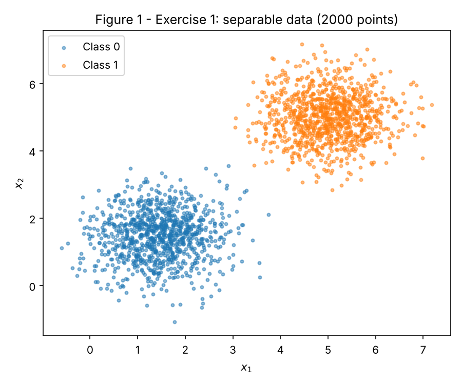
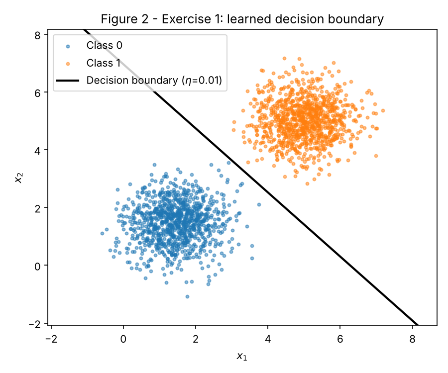
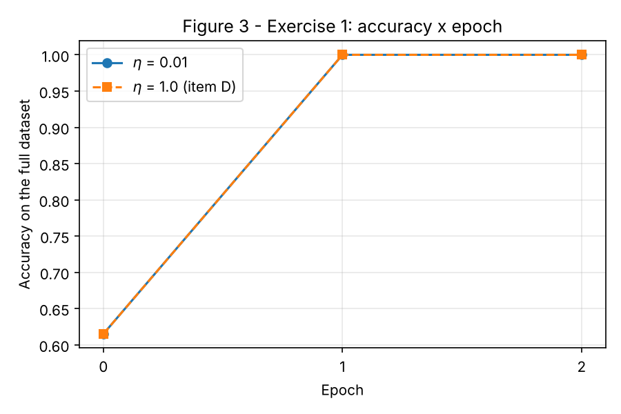
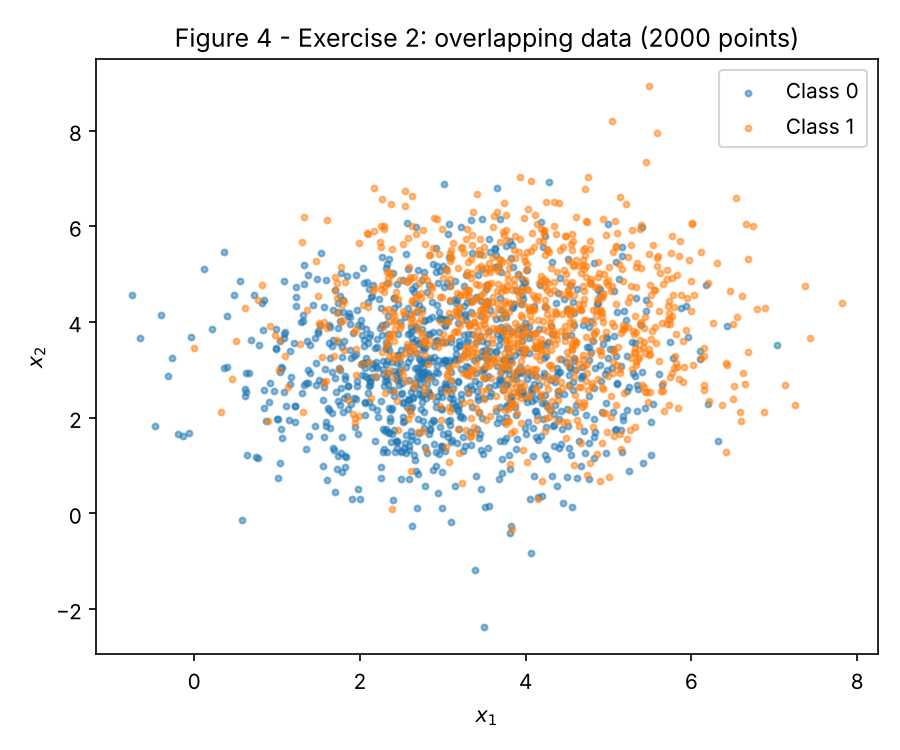
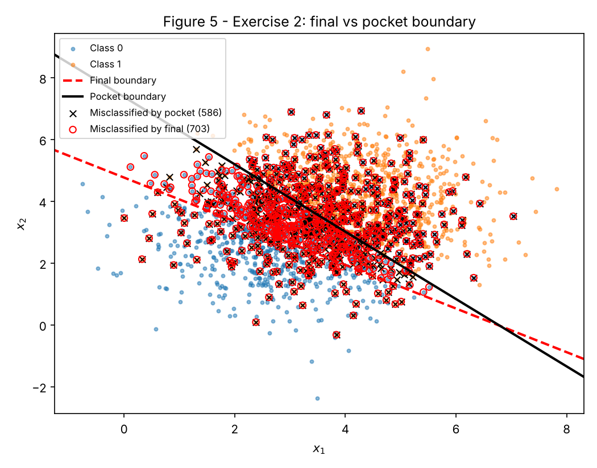
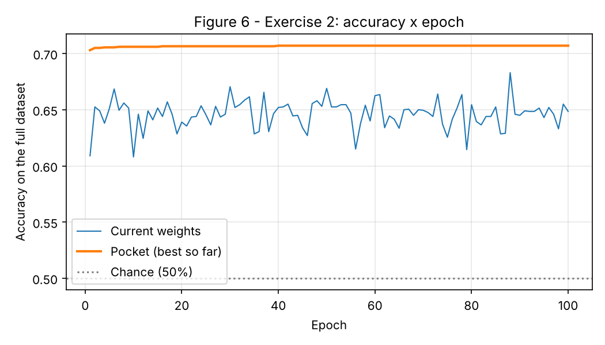

# 2. Perceptron

## Implementation approach

Everything lives in one script, [`code/perceptron.py`](code/perceptron.py), written with NumPy and Matplotlib only. It generates both datasets, trains the perceptron, saves Figures 1 to 6 to `figures/`, and writes every number quoted below to [`code/results.json`](code/results.json). To reproduce from the repository root:

```bash
pip install -r requirements.txt
python docs/exercises/perceptron/code/perceptron.py
```

Design choices:

- **One generator.** `rng = np.random.default_rng(42)` is created once at the top and used, in this order, for: Exercise 1 data, the Exercise 1 initial weights, Exercise 2 data, the Exercise 2 initial weights. Nothing else draws random numbers, so the numbers below are identical on every run.
- **Shuffling.** After the 1000 + 1000 points are drawn, the rows are permuted once (with the same `rng`). Without this the online loop would see all of Class 0 and then all of Class 1, which only changes the order of updates, but makes the run depend on an arbitrary stacking order.
- **One training function.** `train_perceptron` implements the activation, the prediction, the `{0,1}` error-driven rule and the stopping condition. Exercise 2 calls the same function unchanged; the pocket bookkeeping (a full-dataset accuracy check after each update, and a copy of `(w, b)` when it improves) is inside it and is harmless on separable data, where the pocket simply ends equal to the final weights.
- **Same initialization for the η = 1.0 re-run.** `w` is drawn once from `rng.normal(0, 0.01, size=2)` and the same vector is passed to both Exercise 1 runs, so η is really the only thing that changes.

Challenges: the pocket check evaluates the whole dataset after every update (about 78 000 updates in Exercise 2), which is the slowest part, but the script still runs in about 10 s. Figure 3 includes an epoch-0 point (accuracy of the initial weights) because Exercise 1 converges so fast that a curve starting at epoch 1 would be flat.

Code (pulled from the file that was run):

``` python
--8<-- "docs/exercises/perceptron/code/perceptron.py"
```

## Exercise 1

### A — Generate the data

Class 0: mean [1.5, 1.5], covariance [[0.5, 0], [0, 0.5]]. Class 1: mean [5, 5], covariance [[0.5, 0], [0, 0.5]]. 1000 samples per class (function `make_dataset`).



*Figure 1. The two classes are far apart relative to their spread: there is a wide empty corridor between them.*

### B — Implement the perceptron

- Prediction: ŷ = step(w·x + b), with step(z) = 1 if z ≥ 0 and 0 otherwise (`step`, `predict`).
- Update, for each sample: w ← w + η(y − ŷ)x and b ← b + η(y − ŷ). The error y − ŷ is 0 on a correct prediction, +1 on a false negative and −1 on a false positive, so both kinds of mistake get corrected.
- Initialization: w = [0.00991, −0.00827] (drawn from `rng.normal(0, 0.01, size=2)`), b = 0.
- η = 0.01; stop after an epoch with zero updates or after 100 epochs; accuracy on the full dataset recorded after every epoch.

### C — Train and measure

- Final **w = [0.03189, 0.02874]**, final **b = −0.200**.
- **Epochs: 2.** Epoch 1 made 48 updates; epoch 2 made 0 updates, which is the stopping condition.
- **Final accuracy: 100.0%** (0 misclassified points). The initial weights scored 61.5%.

The boundary 0.03189·x₁ + 0.02874·x₂ − 0.200 = 0 crosses the diagonal x₁ = x₂ at 3.30, inside the empty corridor between the two means (1.5 and 5).



*Figure 2. Decision boundary over the data. No point is misclassified, so there are no markers.*



*Figure 3. Accuracy × epoch (epoch 0 = initial weights). Both learning rates reach 100% at the end of epoch 1 and stop at epoch 2.*

### D — Analysis

**1. Why separable data converges quickly.** An update happens only when y − ŷ ≠ 0, i.e. only on a mistake. Each mistake pushes w toward the misclassified point (+x for a false negative, −x for a false positive), so the boundary moves to the correct side of it. Because a separating line exists with a large margin, the number of points the current line gets wrong can only shrink: here it went from 48 updates in epoch 1 to 0 in epoch 2. Once a full pass has no mistakes, nothing in the rule can change w or b anymore, so training stops by itself.

**2. η = 1.0.** Same data, same initial w, only η changed:

| Run | Epochs | Updates (epoch 1) | Accuracy | w | b | w / ‖w‖ |
|---|---|---|---|---|---|---|
| η = 0.01 | 2 | 48 | 100% | [0.03189, 0.02874] | −0.20 | [0.7429, 0.6694] |
| η = 1.0 | 2 | 25 | 100% | [1.71734, 1.66459] | −11.0 | [0.7181, 0.6960] |

The two directions differ by 2.09°, and the boundaries cross the diagonal at 3.30 and 3.25: both separate the data perfectly, but they are different lines. Writing the weights after the training as w = w₀ + η Σ eᵢxᵢ (eᵢ = ±1 on the mistakes), dividing by η gives w/η = w₀/η + Σ eᵢxᵢ. The boundary only depends on w up to scale, so what matters is how big the initial vector is compared with one update. With ‖w₀‖ ≈ 0.013: for η = 0.01 the initial term w₀/η has norm ≈ 1.3, comparable to a single data point (‖x‖ between 2 and 7), so the random start still shapes which points are misclassified and in what order. For η = 1.0 the initial term is ≈ 0.013, negligible after the very first update, so the run behaves almost like a zero start. **η therefore controls the relative weight of the initialization against each correction**: it changes the sequence of mistakes (48 vs 25) and hence which of the many separating lines is found, not whether one is found.

**3. Zero start.** Let w₀ = 0, b₀ = 0 and compare two runs with η₁ and η₂ on the same data in the same order. Claim: after every step k, w_k^(2) = (η₂/η₁) w_k^(1) and b_k^(2) = (η₂/η₁) b_k^(1).

- Step 0: both are 0, so the claim holds.
- Inductive step: if the claim holds at step k, then for the next sample w^(2)·x + b^(2) = (η₂/η₁)(w^(1)·x + b^(1)). Since η₂/η₁ > 0, multiplying by it does not change the sign, so step(·) gives the **same ŷ** in both runs and the **same error e = y − ŷ**. The updates are η₁e·x and η₂e·x = (η₂/η₁)·η₁e·x, so after the update the claim still holds.

So both runs make exactly the same mistakes, at the same samples, in the same epochs: same epoch count, and the weights differ only by the factor η₂/η₁. The boundary {w·x + b = 0} is unchanged by scaling (w, b) by a positive constant, so η has no effect at all. Running it confirms this: from zero, η = 0.01 and η = 1.0 both stop at epoch 2, and the ratios of w₁, w₂ and b between the runs are all exactly 100.0. This is why item B forbids the zero start: with it, the η comparison in item 2 would be empty.

## Exercise 2

### A — Generate the data

Class 0: mean [3, 3], covariance [[1.5, 0], [0, 1.5]]. Class 1: mean [4, 4], covariance [[1.5, 0], [0, 1.5]]. 1000 samples per class, same `make_dataset` function and same `rng`.



*Figure 4. The clouds overlap heavily; no straight line separates them.*

### B — Train, keeping the best weights

Same `train_perceptron`, η = 0.01, 100-epoch cap, initial w = [−0.01456, −0.00462] (next draw of the same `rng`), b = 0. The loop never had a clean epoch: it made between roughly 750 and 820 updates in every one of the 100 epochs.

| Weights | w | b | Accuracy |
|---|---|---|---|
| **Final** (after epoch 100) | [0.06818, 0.09646] | −0.460 | **64.85%** |
| **Pocket** (best so far) | [0.07095, 0.06505] | −0.480 | **70.70%** |

The pocket best was found during **epoch 40**. For reference, the best accuracy any straight line reaches on this particular sample (exhaustive sweep over directions and offsets, in the script) is **70.75%**, so the pocket is essentially optimal for this draw. The ~73% in the statement is what the best line reaches in expectation; with the theoretical distributions the Bayes-optimal line x₁ + x₂ = 7 gives Φ(0.577) ≈ 72%, and a finite sample of 2000 points lands a little above or below that.

The final iterate did not drop all the way to 50% in this run; it ends at 64.85% and its per-epoch accuracy wanders between 60.8% and 68.3% (Figure 6). Item D explains why it sits below the pocket and why its value is essentially arbitrary.

### C — Figures



*Figure 5. Final boundary (red dashed) and pocket boundary (black). Black ×: points misclassified by the pocket weights (586). Red circles: points misclassified by the final weights (703).*



*Figure 6. Accuracy of the current weights after each epoch (oscillates, never settles) and of the pocket weights (monotone, flat at 70.7% from epoch 40).*

### D — Analysis

**1. The gap between final and pocket.** The pocket line crosses the diagonal x₁ = x₂ at 3.53, practically at the midpoint (3.5) between the two means, and its direction w/‖w‖ = [0.737, 0.676] is almost the diagonal: that is the best line. The final line crosses the diagonal at 2.79, inside the Class 0 cloud, and is tilted: it labels 75.8% of all points as Class 1, so it misclassifies a large part of Class 0 and only scores 64.85%.

The reason is in the sizes of the steps. Per mistake, b moves by η = 0.01, while w moves by η·x, whose norm is about 0.01 × 5.1 = 0.051 (mean ‖x‖ = 5.11 here). The weights themselves are only ‖w‖ ≈ 0.1, so **one mistake changes w by about half of its own length**, while it changes b by about 2%. The boundary's position along the diagonal is t = −b/(w₁ + w₂); a single false negative adds x₁ + x₂ ≈ 7 × 0.01 = 0.07 to w₁ + w₂ (about 40% of it) but only 0.01 to b, so the line lurches toward Class 0; a false positive does the opposite. Since every possible line misclassifies at least ~29% of the points, there are about 780 such lurches per epoch, and the boundary never stops being kicked around the overlap region. The loop leaves it "there" only because the 100-epoch cap happened to stop it after some last run of mistakes: the final weights are a snapshot of a random walk, not a solution. In a long run the snapshot can be much worse than ours (see item 3: in epochs 401 to 500 the current accuracy went as low as 54.5%, close to the ~50% the statement warns about). The pocket ignores where the walk is now and keeps the best point it ever visited.

**2. Figure 3 vs Figure 6, and the convergence theorem.** The perceptron convergence theorem (Novikoff, 1962) says: if there is a weight vector w* that classifies every training point correctly **with a positive margin γ**, and every point has ‖x‖ ≤ R, then the perceptron makes at most (R/γ)² mistakes in total, whatever the order of the samples. A finite number of mistakes means a finite number of updates, so the weights stop changing and the accuracy curve settles, which is Figure 3 (48 mistakes, then none). The assumption this dataset violates is **linear separability**: no w* with γ > 0 exists, because the clouds overlap. Without it the theorem gives no bound, mistakes keep happening forever (750+ per epoch), and the curve in Figure 6 keeps oscillating.

**3. More epochs? Smaller η?** Neither fixes it.

- *More epochs.* For any (w, b), at least 29% of the points are misclassified, so every epoch triggers hundreds of updates; the rule has no state in which it stops changing. More epochs only lengthen the random walk: the final iterate stays as arbitrary as before, and the only thing that can improve is the pocket. Check (same data, same initial weights, 500 epochs): final accuracy 63.4%, current accuracy in the last 100 epochs between 54.5% and 68.3%, pocket 70.75%.
- *Smaller η.* After the first few updates the initial w is negligible and w ≈ η Σ eᵢxᵢ, b ≈ η Σ eᵢ. As shown in Exercise 1 D3, multiplying η by a constant multiplies w and b by the same constant and leaves the predictions, the mistakes and the boundary unchanged. In particular the relative kick per mistake, ‖ηx‖/‖w‖, does not depend on η, because ‖w‖ itself scales with η. A smaller η gives the same walk at a smaller scale. Check: η = 0.001 for 100 epochs gives a final accuracy of 68.25% and a per-epoch range of 61.0% to 68.35%, the same band as η = 0.01; pocket 70.7%.

What actually fixes it is changing the algorithm, not its settings: keep the pocket (as done here), average the iterates, or use a loss with a decaying step size (e.g. logistic regression) instead of the mistake-driven step rule.

## Results summary

| # | Quantity | Value |
|---|---|---|
| 1 | Exercise 1 — final **w** and b | w = [0.03189, 0.02874], b = −0.200 |
| 2 | Exercise 1 — epochs to convergence | 2 (48 updates in epoch 1, 0 in epoch 2) |
| 3 | Exercise 1 — final accuracy | 100.0% |
| 4 | Exercise 1 — epochs and final accuracy with η = 1.0 | 2 epochs, 100.0% |
| 5 | Exercise 2 — final **w** and b | w = [0.06818, 0.09646], b = −0.460 |
| 6 | Exercise 2 — accuracy of the final weights | 64.85% |
| 7 | Exercise 2 — accuracy of the pocket weights | 70.70% (pocket w = [0.07095, 0.06505], b = −0.480) |
| 8 | Exercise 2 — epoch at which the pocket best occurred | 40 |
