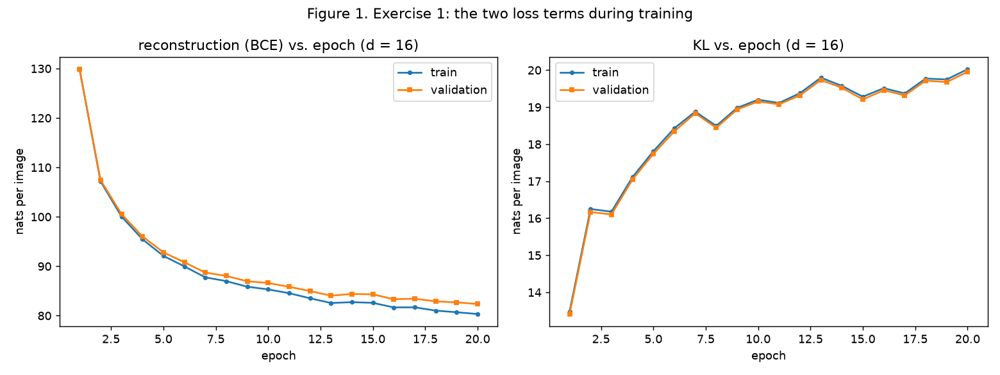
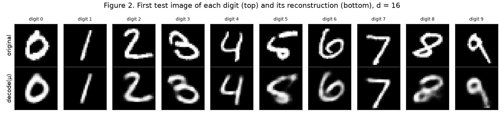
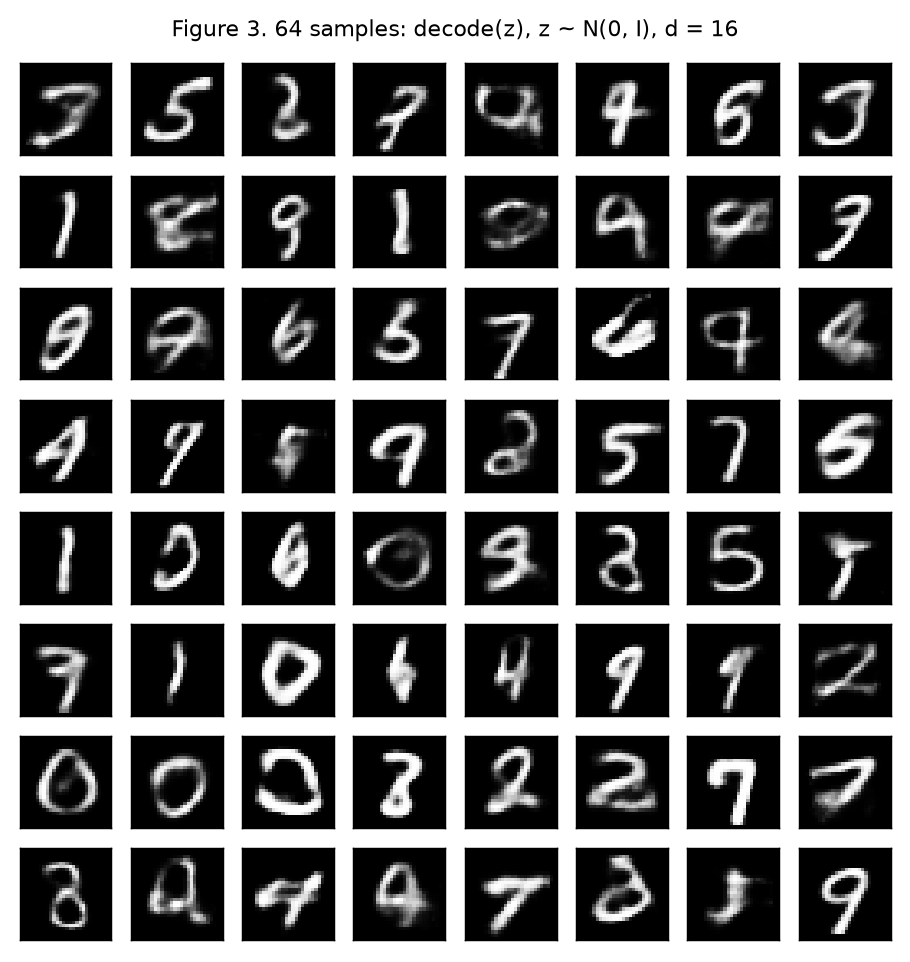
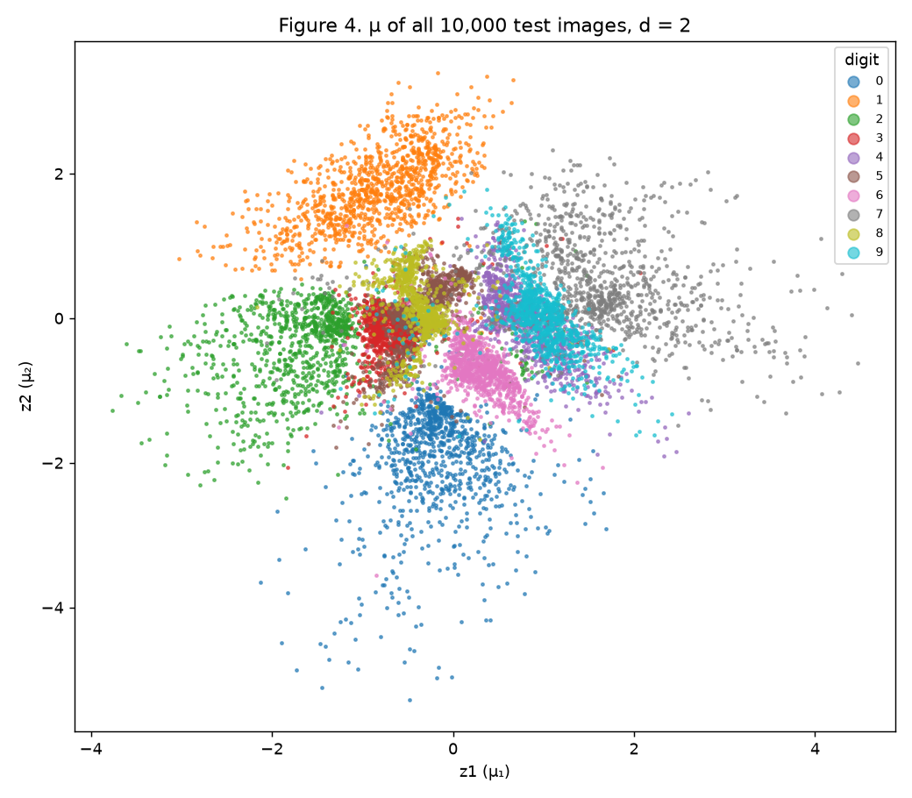
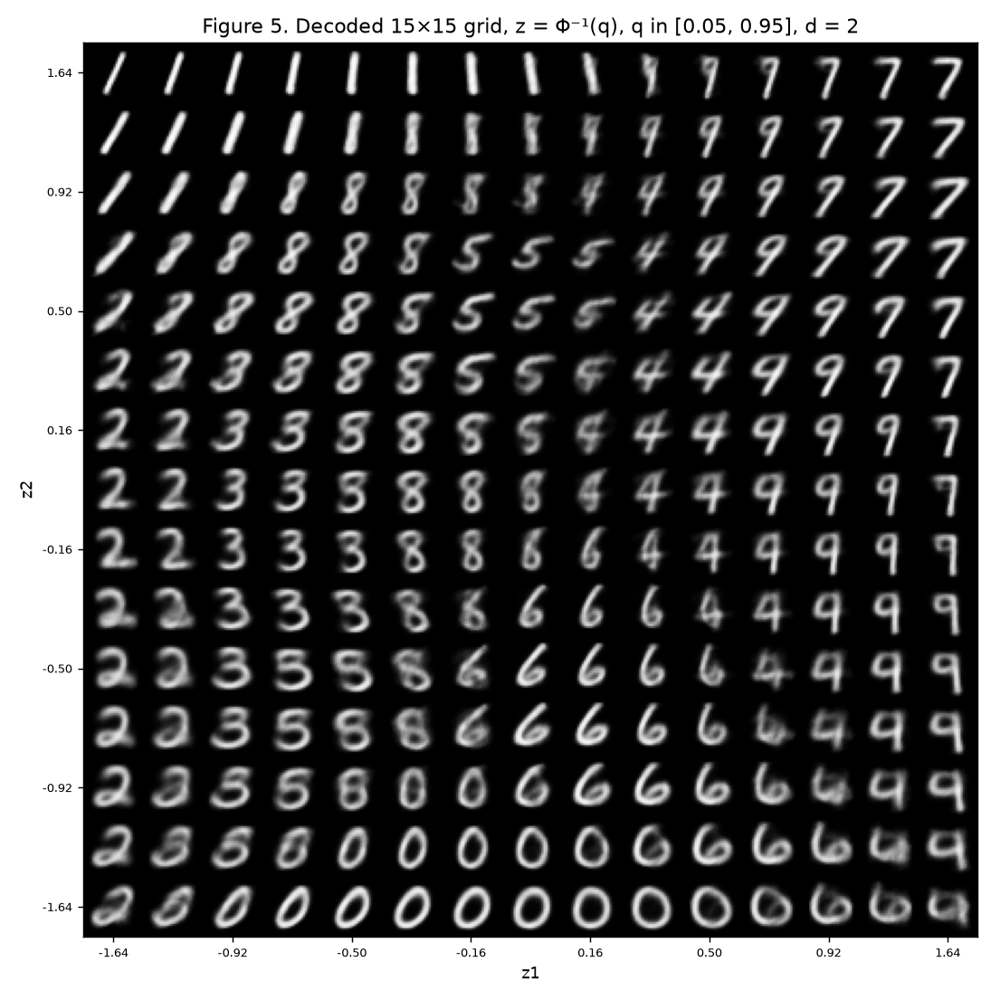
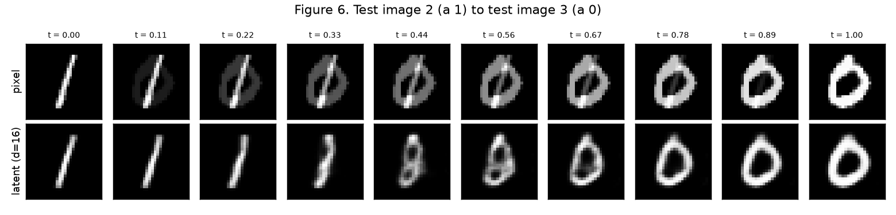

# 4. VAE

## Implementation approach

Everything lives in one script, [`code/vae.py`](code/vae.py), using PyTorch (`torchvision` only to load MNIST), NumPy, Matplotlib and `scipy.stats.norm.ppf`. It trains the d = 16 and the d = 2 models, saves Figures 1 to 6 to `figures/` and writes every number quoted below to [`code/results.json`](code/results.json). The site's CI workflow runs it when the script changes and commits the figures and `results.json` back to the repository. To reproduce locally from the repository root (MNIST is downloaded to `$MNIST_ROOT`, default `/tmp/mnist`, outside the repository):

```bash
pip install torch torchvision numpy scipy matplotlib
python docs/exercises/vae/code/vae.py
```

Design choices:

- **Seeds.** `torch.manual_seed(42)` is called right before each model is built, and `random_split` uses `torch.Generator().manual_seed(42)`. `torch.use_deterministic_algorithms(True)` and a fixed thread count make runs repeatable on the same machine and PyTorch build. The numbers below come from the CI run that produced the published figures (CPU build of PyTorch); on a different build the losses can differ by about 1 to 2 nats.
- **Written by hand** (no library VAE, no `torch.distributions`): the reparameterization `z = μ + exp(½ log σ²) · ε` with `ε = randn_like(μ)`; the reconstruction term `F.binary_cross_entropy(x̂, x, reduction="sum") / batch`; the closed-form KL `½ Σ (μ² + σ² − 1 − log σ²) / batch`; and the sampling `decode(randn(64, 16))`. Autograd computes the gradients.
- **Logging.** After every epoch, both terms are evaluated on the full train set (50,000) and on the validation set (10,000), each in nats per image. The test set is touched once, after training, for the final numbers.
- **One training function** `train_vae(d)` serves both exercises, so the d = 2 model gets exactly the same data, seed, β = 1, optimizer and budget.

Code (pulled from the file that was run):

``` python
--8<-- "docs/exercises/vae/code/vae.py"
```

## Exercise 1

### A. Data

MNIST from `torchvision`, `ToTensor()` (pixels in [0, 1]), flattened to 784-vectors. The 60,000 official training images are split with `random_split(..., [50000, 10000], generator=torch.Generator().manual_seed(42))` into **50,000 train and 10,000 validation**. The 10,000 official test images are the test set, used only for the final numbers.

### B. Model

- Encoder: 784 → 512 → 256, ReLU after each layer.
- Heads: two separate linear layers 256 → 16, one for μ and one for log σ².
- Decoder: 16 → 256 → 512 → 784, ReLU on the hidden layers, sigmoid output (each output is the Bernoulli probability of a pixel).
- Loss per image, β = 1, averaged over the batch: reconstruction = BCE summed over the 784 pixels; KL = ½ Σᵢ (μᵢ² + σᵢ² − 1 − log σᵢ²) summed over the 16 latent dimensions. Their sum is the negative ELBO.

Predicting log σ² rather than σ keeps the variance positive without a constraint (σ² = exp(log σ²)), and the KL formula uses log σ² directly.

### C. Training

Adam, learning rate 10⁻³, batch size 128, 20 epochs.

**Test set (d = 16): reconstruction 81.69 nats, KL 19.99 nats, negative ELBO 101.68 nats per image**, in line with the reference (about 81 and 20).

On validation, the reconstruction term goes from 129.83 (epoch 1) to 82.36 (epoch 20), and the **KL goes from 13.41 (epoch 1) to 19.95 (epoch 20)**. Train and validation track each other closely (final train: 80.34 and 20.03), so there is little overfitting in 20 epochs.



*Figure 1. Left: reconstruction term per epoch. Right: KL term per epoch. Train and validation, in nats per image.*

### D. Reconstructions and samples



*Figure 2. Top: the first test image of each digit (test indices 3, 2, 1, 18, 4, 8, 11, 0, 61, 7 for digits 0 to 9). Bottom: decode(μ(x)). The digit identity and the stroke shape are kept; edges are softer than in the originals.*



*Figure 3. 64 images decoded from z ~ N(0, I) after `torch.manual_seed(0)`. Many are clear digits, but a good share are blurry, broken, or halfway between two digits.*

### E. Analysis

**1. Why the KL rises while the total loss falls.** At initialization the encoder outputs are close to μ ≈ 0, σ ≈ 1 for every image, which is exactly the prior, so the KL is near zero; but then z carries no information about x and the reconstruction is terrible. The cheapest way to cut the loss is to make z informative: move μ apart for different images and shrink σ, which buys a large drop in reconstruction (130 → 107 nats on validation in the first two epochs) at the price of a much smaller increase in KL (13.4 → 16.2). The total keeps falling (143.3 → 123.6 → 116.7 → 113.1 over epochs 1 to 4) because every nat of KL spent buys several nats of reconstruction. The KL is the price of information about x carried in z (it bounds that information), so it grows as the encoder learns to use the latent space and then levels off near 20 nats once extra information stops paying for itself.

**2. Why Figure 3 looks worse than Figure 2.**

- *Where prior samples land.* Figure 2 decodes μ(x) of real images, which are points the decoder was trained on. Figure 3 decodes points drawn from N(0, I), and the encoder does not fill that ball evenly. It uses only part of the space: **5 of the 16 dimensions collapsed** (the spread of μ across test images is about 0.03 in those dimensions and about 1.0 in the other 11, and their σ is ≈ 1, so q(z | x) there is just the prior), and in the active dimensions the codes form clusters with gaps between them. A prior sample's median distance to the nearest encoded test image is 2.76, against 1.52 between two encoded test images. So many prior samples land in holes between the digit clusters. The decoder never saw those regions, so it produces mixtures of digits or broken strokes.
- *What the decoder outputs for a given z.* The decoder outputs the per-pixel *mean* p(x | z), not a sample, and each z it was trained on stood for a whole neighbourhood of slightly different images (σ > 0, plus the many images that map nearby). Under BCE the best answer for an uncertain pixel is an intermediate probability, so edges come out grey. The less certain the decoder is about a z, the more of the image is grey: **11.3% of pixels are "undecided" (between 0.2 and 0.8) in the prior samples, 9.4% in decode(μ) of test images, and 6.1% in the real test images.** Prior samples, which sit in less-familiar regions, get the most blur.

**3. Why Figure 2 decodes μ and not a sampled z.** μ is the centre of q(z | x), the single most representative code for that image. A sampled z = μ + σε adds noise (here σ is between 0.09 and 0.33 in the 11 active dimensions, mean 0.19), which would show the decoder's response to a random nearby point and mix in sampling noise. A reconstruction figure should show what the model keeps about x, so it uses the deterministic, most likely code. Sampling is only needed during training, where it makes the decoder robust to the whole neighbourhood and makes the ELBO estimate correct.

## Exercise 2

### A. Train a 2-D VAE

Same data, split, architecture (heads 256 → 2), seed, β = 1, optimizer and 20 epochs; only d changes.

| | test reconstruction | test KL | negative ELBO |
|---|---|---|---|
| d = 16 | 81.69 | 19.99 | 101.68 |
| d = 2 | **134.03** | **6.67** | 140.70 |

As expected (about 135 and 7): with 2 latent numbers the model stores far less information about each image (6.7 nats of KL instead of 20), and the reconstruction is 52 nats worse.

### B. Encoded test set



*Figure 4. μ for all 10,000 test images, coloured by digit. 0, 1, 2 and 7 form well separated arms; 3, 5 and 8 pile up in the middle; 4 and 9 share one region on the right.*

### C. Decoded plane



*Figure 5. Decoder outputs on a 15×15 grid, zᵢ = Φ⁻¹(qᵢ) with q = 15 evenly spaced values in [0.05, 0.95], so z runs from −1.645 to 1.645.*

Because Φ⁻¹ maps equal steps in cumulative probability to z, consecutive grid lines enclose the same prior probability along each axis (0.9/14 each), and since the prior N(0, I) factorises over z₁ and z₂, every cell of the grid holds the same prior mass.

### D. Interpolation

Test image **2** (a "1") and test image **3** (a "0"), the first test 1 and the first test 0.



*Figure 6. Ten steps, t = 0 to 1. Top: (1 − t)xₐ + t x_b in pixel space. Bottom: decode((1 − t)μₐ + t μ_b) with the d = 16 model.*

### E. Analysis

**1. Overlapping digits.** In Figure 4 the clearest overlaps are **5 and 8** (with 3, in the middle, around z ≈ (−0.4, 0.1)) and **4 and 9** (on the right, around z ≈ (0.9, 0)). Counting test points whose nearest digit centroid belongs to another digit, the worst pairs are 5 ↔ 8 (867 points) and 4 ↔ 9 (632), then 3 ↔ 5 (338). Figure 5 shows the same transitions as gradual morphs. Along the right half of the middle rows, 4s turn into 9s: the in-between images are a 4 whose open top slowly closes into a loop, and at the crossover you get a figure that could be read as either. In the centre, 8s become 5s and 3s: the in-between images are an 8 whose left side fades (looking like a 3) or whose upper-right loop opens (looking like a 5). These digits differ by one or two strokes, so a 2-D code puts them next to each other.

**2. What two numbers force the model to discard.** With d = 2 the code has room for little more than "which digit, roughly" and one or two shape factors. Figure 5 shows what survives: each digit appears in only a few versions, varying smoothly in slant and thickness, all of them clean and prototypical. Everything else is discarded: the exact stroke path, the width and length of individual strokes, small loops and hooks, and broken or extra strokes. The decoder can only redraw the average image of that region of the plane, so a reconstruction from d = 2 is a "typical" version of the digit, not the image itself. That missing detail is exactly the extra 52 nats of reconstruction loss (134 vs 82), and the lower KL (6.7 vs 20 nats) is the measure of how much less information each code carries.

**3. Pixel vs latent interpolation.** The **latent row passes through digit-like images**: the 1 tilts and thickens, bends into a narrow loop and widens into the 0, and every intermediate frame is a plausible handwritten stroke. The **pixel row does not**: every frame is a cross-fade, a faint 1 overlaid on a faint 0, with grey half-intensity pixels that no real digit has. The reason is that the set of real digit images is a curved, low-dimensional manifold inside the 784-dimensional pixel space; a straight line between two points of it leaves the manifold, and its middle points are just averages of pixels. The encoder maps that manifold to a space where similar images are close, so a straight line between μₐ and μ_b stays in regions the decoder learned, and decoding it walks along the manifold instead of cutting through it.

## Results summary

| # | Quantity | Value |
|---|---|---|
| 1 | Ex. 1: test reconstruction, KL, and negative ELBO (d = 16) | 81.69, 19.99, 101.68 nats per image |
| 2 | Ex. 1: validation KL at the first and last epoch | 13.41 (epoch 1), 19.95 (epoch 20) |
| 3 | Ex. 2: test reconstruction and KL (d = 2) | 134.03, 6.67 nats per image |
| 4 | Ex. 2: the two test indices interpolated | 2 (digit 1) and 3 (digit 0) |
